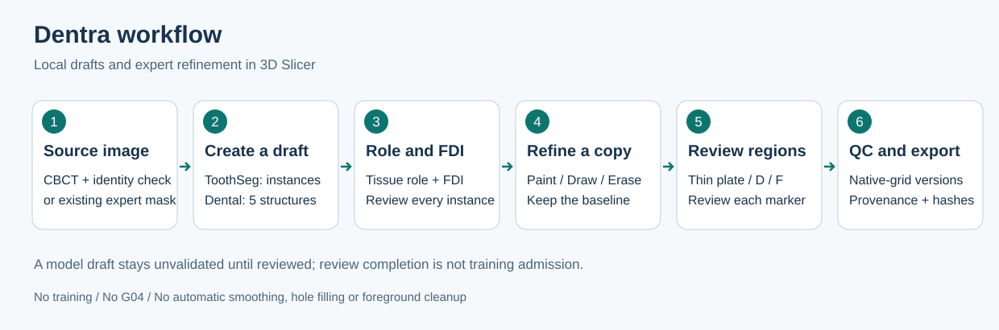
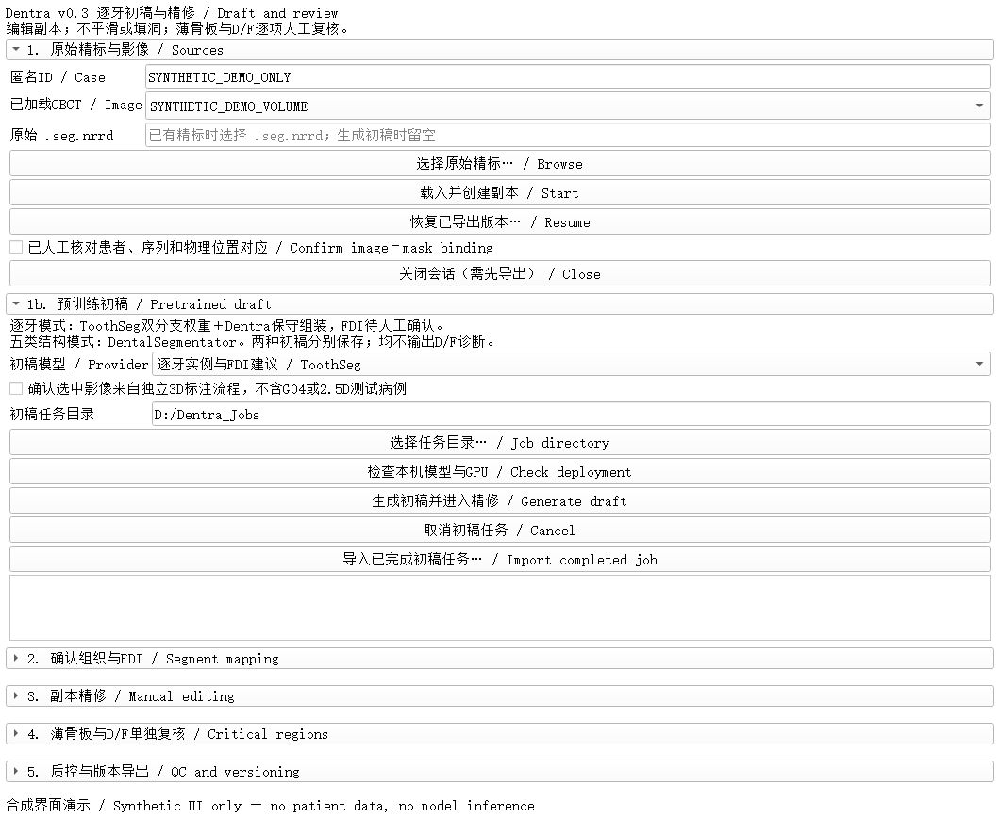
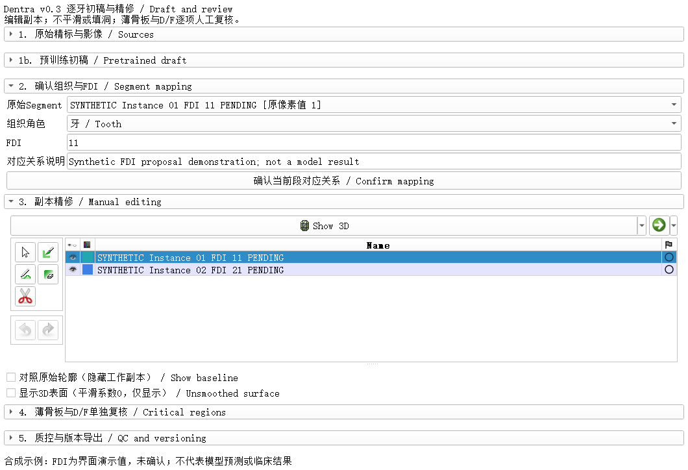
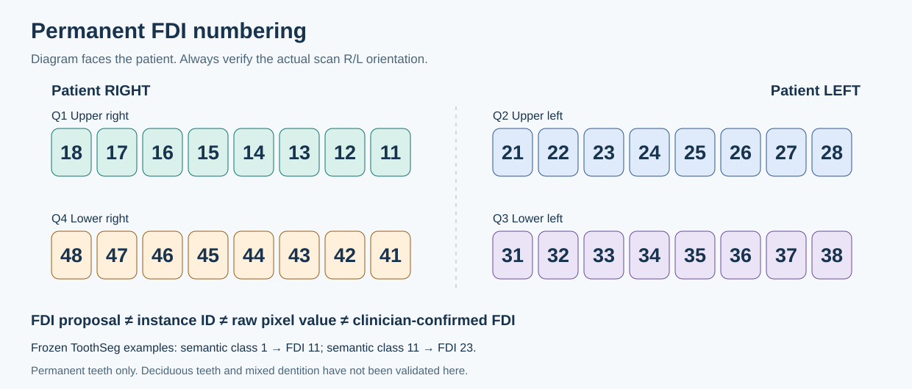
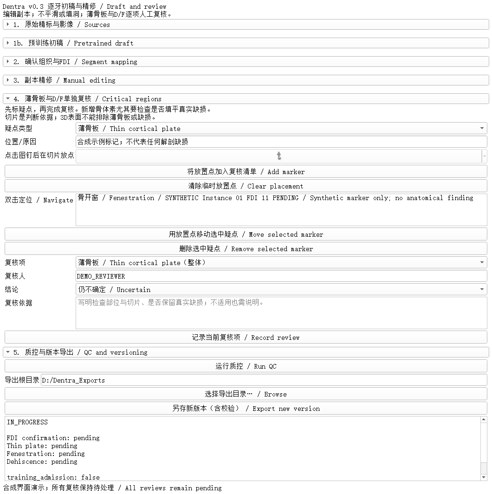

# Dentra

**CBCT 逐牙初稿与 3D Slicer 专家精修工具**  
Local CBCT drafts, FDI confirmation and expert segmentation review.

Dentra 将预训练分割初稿、逐牙 FDI 确认、人工精修、缺损复核和版本导出接入同一个 Slicer 模块。原始影像和分割基线保留，医生在工作副本上编辑；每次导出记录来源、修改、复核依据及 SHA-256 校验。

当前为研究标注工具。**FDI 是待确认建议；模型不输出 D/F 诊断，也不自动生成精细牙槽骨真值。** 不训练，不自动平滑、填洞或删除小连通域；薄骨板、骨开窗和骨开裂分别人工复核。



流程图说明：选择影像或已有标注 → 生成初稿 → 确认组织和 FDI → 精修副本 → 分项复核 → 质控与版本导出。已有精标可以直接进入精修，不必运行模型。

导航：[快速使用](#已部署机器上的快速使用) · [首次部署](#首次部署) · [生成初稿](#载入影像并生成初稿) · [FDI确认](#确认逐牙-fdi-和组织角色) · [人工复核](#薄骨板-开窗-开裂分别复核) · [导出恢复](#质控-导出和恢复)

## 先选适合的入口

| 你的情况 | 使用入口 | 是否需要模型部署 |
| --- | --- | --- |
| 已有医生 `.seg.nrrd`，只想精修和质控 | “选择原始精标” → “载入并创建副本” | 不需要 GPU 或 WSL 推理环境；需要 Slicer |
| 需要逐牙实例和编号建议 | 选择 “逐牙实例与 FDI 建议 / ToothSeg” | 需要 ToothSeg 双分支权重和通过预检的 GPU |
| 需要颌骨、牙群、下颌管参考初稿 | 选择 “五类结构 / DentalSegmentator” | 需要 DentalSegmentator 权重和通过预检的 GPU |

两个模型的结果分开保存。牙群不是单牙；整颌骨不是精细牙槽骨；ToothSeg 牙体实例不包含牙槽骨。不要直接互改这些组织语义。

## 已部署机器上的快速使用

1. 双击完整目录中的 `Start_Dentra.cmd`，进入 **CBCT Research → Dentra**。
2. 在 Slicer 载入原始 CBCT，选择正确体积并输入匿名病例 ID。
3. 选择所需初稿模型，点击“检查本机模型与 GPU”。部署检查通过后，确认影像来源范围，再点击“生成初稿并进入精修”。已有精标则直接载入副本。
4. 初稿导入后先核对患者、序列、左右与物理位置，勾选影像绑定确认，再逐段确认组织角色和 FDI。
5. 在副本上精修；分别复核薄骨板、开窗、开裂，以及每一个已标记疑点。
6. 运行质控，选择导出目录，点击“另存新版本”。未完成的项目可先保存为 `IN_PROGRESS`。

首次部署按下文操作；完整独立指南另见 [Markdown](OPERATION_GUIDE.md)、[Word](docs/Dentra_Operation_Guide_v03.docx) 和 [PDF](docs/Dentra_Operation_Guide_v03.pdf)。

## 首次部署

### 1 安装条件与本次验证环境

| 组件 | 已验证配置或当前约束 |
| --- | --- |
| 显示与精修 | Windows 3D Slicer 5.10.0 |
| 模型后端 | WSL Ubuntu-22.04；独立 `dentra_v03` 覆盖环境 |
| 基础计算环境 | 已有可正常使用 CUDA 的 PyTorch Python；本次为 PyTorch 2.10.0+cu128 |
| 后端依赖 | 固定版本见 [requirements-backend.txt](config/requirements-backend.txt) |
| GPU | 本次 GPU 1，RTX PRO 5000 Blackwell，48 GB 显存 |
| ToothSeg 资源门槛 | GPU 1 空闲显存至少 36 GiB；原始输入最多 125,000,000 体素 |
| 五类结构资源门槛 | 当前冻结协议要求至少 12 GiB 空闲显存 |
| 主机内存 | 本次 WSL 可见约 31 GiB，并有既存 swap；这不是所有机器的最低配置承诺 |
| 模型输出空间 | 回到原始载入 CBCT 的网格；原始影像和现有精标不改写 |

当前没有 CPU 推理回退，也不会自动降低分辨率、patch 或改变模型设置来适配资源不足的机器。GPU 编号和阈值来自冻结协议，迁移到不同硬件时先审查部署兼容性。

如果只精修已有标注，可跳过模型下载和下面的 WSL 后端部署步骤。

### 2 获取完整项目

在 **WSL Bash 终端**执行，例如将项目放到 Windows 的 `D:/CBCT_Tools/Dentra`：

```bash
git clone https://github.com/shumao469/Dentra.git /mnt/d/CBCT_Tools/Dentra
cd /mnt/d/CBCT_Tools/Dentra
cp config/local_backend.example.json config/local_backend.json
```

不要只复制 `CBCTSegReview.py`。界面、库、后端和配置需要保持目录结构完整。仓库不包含患者影像、精标、模型权重或本机配置。

### 3 填写本机配置

用文本编辑器打开 `config/local_backend.json`，将 `USER` 改为真实 WSL 用户名，并核对发行版和路径：

```json
{
  "distribution": "Ubuntu-22.04",
  "python": "/home/USER/venvs/dentra_v03/bin/python",
  "model_root": "/home/USER/models/cbct_draft/DentalSegmentator_v100",
  "toothseg_model_root": "/home/USER/models/cbct_draft/ToothSeg_14893540"
}
```

- `python` 是将要创建或使用的隔离后端环境，不是 Slicer 自带 Python。
- 两个 `model_root` 分别是两个模型的缓存根目录，不是单个 `.pth` 文件。
- 模型缓存优先放在空间充足的 WSL 磁盘；影像任务目录在界面中另选本地 Windows 盘。
- `local_backend.json` 不提交 Git；示例配置不能代替本机检查。

### 4 下载权重并安装隔离后端

以下命令仍在项目根目录的 **WSL Bash** 中执行。`BASE_PYTHON` 必须指向已有、能正常使用 CUDA 的 Python；下面路径是本次机器示例，其他机器须替换：

```bash
BASE_PYTHON=/home/shu/miniconda/envs/cxr_torch5090/bin/python

"$BASE_PYTHON" -c "import torch; print(torch.__version__); print(torch.cuda.is_available()); print(torch.cuda.device_count())"

# 逐牙实例与 FDI 建议
"$BASE_PYTHON" tools/install_backend.py --provider toothseg

# 可选：需要五类结构初稿时再执行
"$BASE_PYTHON" tools/install_backend.py --provider dental
```

安装器下载官方公开权重，核对大小、MD5、SHA-256、ZIP CRC 和指定模型文件；再在配置指定的 venv 中安装依赖并预检。ToothSeg 下载约 920 MB，DentalSegmentator 约 230 MB，解压和环境安装还需要额外空间。中断下载保留 `.partial`，不要把部分文件当完整权重。

该 venv 通过 `system-site-packages` 只读继承基础 PyTorch，新增依赖写入 venv；它是隔离覆盖层，不是完整复制的独立运行时。**不要在 Slicer Python 控制台运行安装器，不要为此修改既有 2.5D 环境。**

### 5 启动 Slicer

在 Windows 文件管理器双击 `Start_Dentra.cmd`，或在 **Windows PowerShell** 执行：

```powershell
Set-Location D:/CBCT_Tools/Dentra
.\Start_Dentra.cmd
```

若 Slicer 安装在其他位置，明确指定：

```powershell
.\Launch_Slicer_Review.ps1 -SlicerPath 'E:\Program Files (x86)\3D Slicer 5.10.0\Slicer.exe'
```

启动器临时加载完整模块目录，不需要先安装扩展商店包。本次验证的是整目录直接加载，CMake 打包和 Extension Manager 发布尚未验证。模块显示名是 **Dentra**，内部注册名保留 `CBCTSegReview` 以兼容已有接口。

## 载入影像并生成初稿



**界面图说明：** 本 README 的三张截图来自实际 Dentra Qt 模块，使用合成体积和合成标注。没有患者数据，没有在截图制作过程中运行模型；截图中的示例 FDI 不是模型结果。

1. 在 Slicer **DICOM** 模块导入原图目录，选对序列后载入；已有 NRRD/NIfTI 体积也可按 Slicer 常规方式载入。
2. 进入 **CBCT Research → Dentra**，在“已加载 CBCT / Image”选择体积。使用匿名 ID，例如 `CASE_001`，不要填写姓名或路径。
3. 查看左右、上下颌、视野和影像来源。只有明确属于本独立 3D 标注流程的输入才进入本工具；G04 和 2.5D 测试病例继续隔离。匿名化或改文件名不能证明队列独立。
4. 在“初稿模型 / Provider”选 **逐牙实例与 FDI 建议 / ToothSeg**，或选 **五类结构 / DentalSegmentator**。只部署了 ToothSeg 时，应先切换到 ToothSeg 再预检。
5. 选择本地任务目录，例如 `D:/Dentra_Jobs`。目录会保存完整输入影像及结果，应放在受控位置；当前不支持 UNC 或网络共享路径。
6. 点击“检查本机模型与 GPU”。日志出现 `READY` 且界面提示部署通过后，核对输入范围确认框，再点击“生成初稿并进入精修”。
7. 等待初稿生成、来源核验与 Slicer 导入完成。日志中的前向次数不是完成百分比；`semantic_native_channel_export` 等是正常输出阶段。导入和回读检查也会耗时，不要重复启动任务。

成功导入后进入工作副本，组织、FDI 和解剖复核仍待确认。若需取消，点击“取消初稿任务”并等待后端在阶段边界退出；失败任务保留，重新尝试必须建新任务，不覆盖旧任务。

### 已有精标时的另一条路径

载入对应 CBCT，点击“选择原始精标”选择原始 `.seg.nrrd`，再点“载入并创建副本”。先核对患者、序列与物理位置，然后勾选影像绑定确认。当前支持已有二值标签；仅有表面模型或带父变换的数据需先做明确坐标审查，不自动转换或硬化变换。

## 确认逐牙 FDI 和组织角色



1. 初稿导入后核对原图与分割的患者、序列、左右及物理位置，勾选“已人工核对患者、序列和物理位置对应”；未确认时编辑保持只读。
2. 在“原始 Segment”逐段选择实例，结合切片核对边界和牙位。实例名称中的 `PENDING` 或 `unknown` 表示待处理。
3. ToothSeg 实例选择“牙 / Tooth”，检查 FDI 框中的建议，必要时修正，再点击“确认当前段对应关系”。不确定时保留待确认并写明原因，不为通过质控而随意编号。
4. 每个实例分别确认。修改映射不会改写保存于来源记录中的原始模型建议。
5. 五类结构模式保留 `jaw_bone`、`teeth_group` 和 `nerve_canal` 语义；不能把牙群直接确认成某一颗 FDI，或把整颌骨直接改成精细牙槽骨真值。



编号图为**面对患者的示意**，不能替代实际 CBCT 的 R/L 方向标记。当前支持恒牙 FDI 11–48 的有效牙位；乳牙、混合牙列等适用性未验证。图中映射示例来自冻结的 ToothSeg 类别定义：语义类 1 对应 FDI 11，语义类 11 对应 FDI 23。

| 字段或提示 | 应如何理解和处理 |
| --- | --- |
| `instance_id` | 独立分割对象编号，不是临床牙位 |
| 原像素值、`Segment_11` 等名称 | 不自动等于 FDI，需核对来源 |
| `proposed_fdi` | 模型建议，与医生最终确认值分开保存 |
| `hard_vote_fraction` | 实例内离散语义投票比例，不是校准置信度或准确率 |
| `DUPLICATE_FDI_PROPOSAL` | 多个实例建议同一牙位；保留各实例，医生检查断片、粘连或错误编号 |
| `BACKGROUND_OR_TIED_SEMANTICS` | 背景占优或票数并列，编号保留未知 |
| `BORDER_ONLY_NO_CORE` | 有前景但无核心的独立片段，保留供复核 |

医生确认后的重复 FDI 会阻止复核完成。当前精修会话的 segment 数量固定，尚未支持保留完整来源的新增、拆分和合并工作流；涉及同牙多碎片、邻牙粘连或漏牙时，记录待处理并保存草稿，不自动删除或合并，也不靠改成其他组织角色绕过问题。

## 在工作副本上精修

使用 **Paint、Draw、Erase、Scissors** 做有原图依据的局部增删；需要撤销时用 Undo。编辑默认不自动覆盖其他 segment。

- 勾选“对照原始轮廓”时显示保护基线并暂停编辑，取消后回到工作副本。
- 可选 3D 表面只用于辅助显示，平滑系数为 0，不改二值掩膜；薄骨板与缺损判断仍以原图和相邻切片为依据。
- 不使用自动平滑、闭运算、填洞或小连通域删除来让轮廓“更好看”。新增骨体素尤其要检查是否把真实缺损补平。
- 不用 Slicer 通用保存入口覆盖原图、原标注或模型初稿基线；使用模块的“另存新版本”。

## 薄骨板 开窗 开裂分别复核



| 复核项 | 重点检查 |
| --- | --- |
| 薄骨板 `thin_plate` | 原图和相邻切片中的局部骨边界；必要时从另一方向复查 |
| 骨开窗 `fenestration` | 疑似窗孔周围连续边界；新增体素是否误填真实窗孔 |
| 骨开裂 `dehiscence` | 缺损与牙槽嵴边缘的连续关系及相邻切片，不由线名或孔洞形状自动定类 |

上述为操作检查重点，解剖定义与正式真值规范仍由项目医生确认。

1. 完成掩膜和映射调整后，选择对应 segment、疑点类型，填写部位与原因。
2. 点击图钉，在切片放一个点，再点击“将放置点加入复核清单”。双击清单项可回到该位置。
3. 需要细调时，在新位置放临时点，选中疑点，更新说明后点击“移动选中疑点”；明确误标才删除标记。
4. 在“复核项”中分别记录三个整体类别，以及每个已标记疑点。填写医生匿名 ID、结论和依据。
5. “不适用”必须说明原因；仍不能判断就保留“仍不确定”。已标记疑点需要单独实际复核，不能用整体通过代替。
6. 掩膜、名称、映射或点位改变后，旧复核记录会过期，最终状态必须对应当前内容。

**模型保留前景不等于保留全部真实缺损。** ToothSeg 不分割牙槽骨，且其上游训练转换存在牙体参考 mask 填洞习惯；本工具不运行该转换，但预训练权重可能继承该习惯。无本地后处理不能替代专家从原图复核。

## 质控 导出和恢复

### 运行质控并保存

1. 点击“运行质控 / Run QC”，处理映射、几何、重复编号和复核提示。
2. 在“导出根目录”选择受控位置，例如 `D:/Dentra_Exports`。
3. 点击“另存新版本（含校验）”。每次创建新版本目录，保存后重新读取分割核对原生掩膜指纹。

```text
CASE_001_时间戳_版本号/
├── refined.seg.nrrd            # 精修掩膜，保留来源标签
├── critical_regions.mrk.json   # 疑点与导航坐标
├── review.json                 # 映射、改动、复核与来源记录
└── SHA256SUMS.txt              # 当前版本校验
```

| 状态 | 含义 |
| --- | --- |
| `READY` | 所选模型的本机部署预检通过 |
| `MODEL_DRAFT` | 模型初稿，尚未成为独立人工真值 |
| `IN_PROGRESS` | 仍有待处理项，可以保存草稿 |
| `REVIEW_COMPLETE` | 本工具要求的工程检查和复核记录齐备 |
| `FAILED` / `CANCELLED` | 未成功发布新结果；保留任务供排查 |

任何状态都不自动代表训练准入或临床有效。即使 `REVIEW_COMPLETE`，`training_admission` 和 `clinical_validation` 仍为 `false`。

### 下次恢复同一版本

- **已有精标会话：** 载入同一 CBCT 和原始 `.seg.nrrd`，建立副本后点击“恢复已导出版本”，选择版本目录，再核对影像绑定。
- **模型初稿会话：** 载入同一 CBCT，点击“导入已完成初稿任务”选择含 `job.json` 与 `result/` 的任务根目录，重建模型基线；再恢复精修版本。
- 模型任务中的 `slicer_source/model_draft.seg.nrrd` 也可作为原始入口，模型来源标签仍应保留。
- 不把精修结果当新的原始基线，否则差分含义会改变。版本目录不包含 CBCT，恢复依赖原图和原始基线；只有一个精修文件并不足以恢复完整审计链。

## 常见问题

| 问题 | 处理方法 |
| --- | --- |
| 找不到 `Slicer.exe` | 用启动脚本的 `-SlicerPath` 指定安装位置 |
| WSL 无法启动或发行版错误 | 检查 `wsl -l -v` 与 `local_backend.json` 的发行版和 Python 路径 |
| 只装了 ToothSeg，却提示缺少另一模型 | 先在 Provider 切换到 ToothSeg，再点部署检查 |
| `local_backend.json` 缺失或含 `USER` | 从示例复制并修改为本机实际配置 |
| 权重、plans 或 checkpoint 校验失败 | 保留异常文件，核对固定清单后重新下载，不绕过校验 |
| GPU 不存在或空闲显存不足 | 查看占用；不要未经审查修改权重、patch、spacing 或降低模型设置 |
| 日志前向次数不再变化 | 可能进入原网格导出、压缩、Slicer 导入或回读；先查任务状态，勿重复点击 |
| 无法编辑 | 先完成患者—影像绑定确认；检查是否正在显示基线对照 |
| 编号未知或重复 | 查原图并逐牙确认；保留不确定项，不自动删碎片或强制唯一编号 |
| 复核后又变成待处理 | 内容签名已变化，对当前掩膜、映射和点位重新复核 |
| `outside_reference_volume` 或几何不符 | 先核对影像、标注与坐标，不强制重采样、换 ID 或硬化变换来绕过 |
| `.partial_result` 或导出失败 | 读 `FAILED.json` / `EXPORT_FAILED.txt`，保留旧完整结果，另建任务或版本 |

## 验证范围和开发资料

本次已完成 41 项核心测试、16 组逐通道导出数值一致性比较、Slicer 精修与实例/FDI 往返检查，以及一个本地体积的实际双分支试跑。该次后端耗时约 497 秒，保留 58 个实例和 30 个非空 FDI 建议；**这些输出数量不是实际牙数、正确编号数或准确率**，也不是其他机器的耗时承诺。

尚未评价 Dice、FDI 准确率或 D/F 诊断性能；医生解剖验收和跨队列身份去重仍待完成。2.5D 主线、固定五折及 392 牙分母不变；G04 不导入、不调参、不做正式评价，959 牙塌缩伪标签继续禁用。

- [验证报告及边界](VALIDATION.md) · [机器可读验证摘要](validation/RELEASE_VALIDATION_V03.json)
- [ToothSeg 权重与后处理审计](TOOTHSEG_AUDIT.md) · [五类结构模型审计](MODEL_AUDIT.md)
- [开发与合并规范](DEVELOPMENT.md) · [Codex 接管指令](CODEX_START_PROMPT.txt)
- [数据协议](data_contract.json) · [任务清单](tasks.csv) · [第三方模型与许可声明](THIRD_PARTY_NOTICES.md)
- [截图来源说明](docs/images/SCREENSHOT_PROVENANCE.json)

核心测试可在无 Slicer、CUDA 和权重的 Python 环境中执行：

```bash
python -m pip install numpy scipy scikit-image
python tools/run_core_tests.py
```

当前仓库未配置 GitHub Actions；本地验证报告已提交。涉及掩膜、坐标、来源、FDI 或复核逻辑的修改需重跑对应检查。患者影像、精标、任务目录、原始日志、权重和本机配置不进入 Git；不要在公开 issue 上传患者信息。

## English quick reference

Dentra runs on Windows 3D Slicer with an optional local WSL inference backend. Choose ToothSeg for tooth-instance drafts and unconfirmed permanent FDI proposals, DentalSegmentator for five aggregate anatomical classes, or open an existing expert segmentation directly. Confirm image binding, review every role/FDI, refine the working copy, independently review thin plate/fenestration/dehiscence and every marker, then export a version with provenance and checksums.

All three UI screenshots use synthetic data; displayed FDI values were staged for illustration and are not network predictions. No training, automatic smoothing, hole filling, small-component deletion, G04 tuning or formal external evaluation is performed. Dentra's conservative ToothSeg assembly differs from the published full self-correction pipeline; published accuracy does not transfer to this variant.
